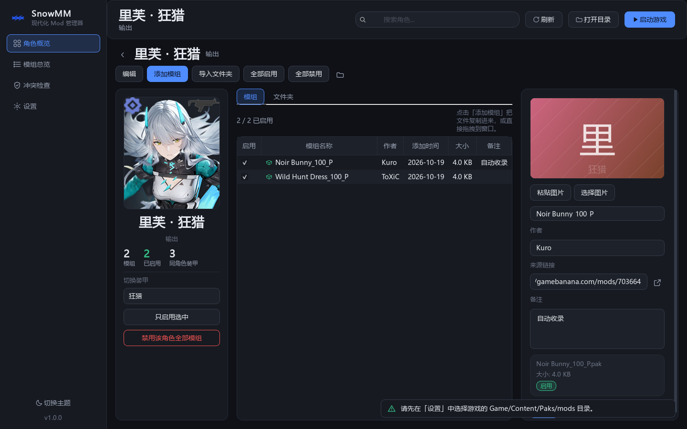

# SnowMM · 尘白禁区 Mod 管理器

[English](README_EN.md) · [更新记录](CHANGELOG.md) · [问题反馈](https://github.com/theresa-2333/SnowMM/issues)

当前版本 **v1.1.0**：新增皮肤分类、英文目录自动兼容、页面内画廊、压缩包导入及基地／杂项卡片。
支持简体中文 / English，全部图鉴资源随应用打包，日常使用无需联网。
升级与验证说明见 [v1.1 更新说明](docs/UPDATE_1.1.md)。

## 下载与运行

在 [GitHub Releases](https://github.com/theresa-2333/SnowMM/releases) 下载
`SnowMM-1.1.0-windows-x64.zip`，**完整解压**后运行 `SnowMM/SnowMM.exe`。
请保留旁边的 `_internal` 文件夹；这是便携应用目录，并非单文件 EXE。

从源码运行（Python 3.10 或更新版本）：

```powershell
python -m pip install -r requirements.txt
python main.py
```

首次运行会打开设置，选择游戏中的模组目录，例如：

```text
<游戏目录>/Game/Content/Paks/mods
```

已有模组可在设置中扫描收录。游戏程序路径为可选项，用于「启动游戏」按钮。

## 界面预览


| 角色详情 | English |
| --- | --- |
|  |  |

## 主要功能

- **54 位内置角色**：无中文姓名遮挡的角色图、属性分类、收藏、搜索；没有模组的角色同样可以进入详情页。
- **完整双语**：角色、装甲、皮肤、属性名和界面文字跟随语言设置；目录使用稳定英文标识。
- **皮肤切换**：每套装甲都有默认皮肤，并内置 BWIKI 整理的 116 套时装；详情页按皮肤查看和导入，检查器可调整归属。
- **角色页导入**：添加 pak 文件、文件夹或 ZIP／7z／RAR 压缩包；递归发现 pak，自动携带同名 utoc / ucas / sig，每组分别登记。
- **基地／杂项**：主界面提供两张特殊卡片，跳过重复记录和多模组启用检查，仍检查文件缺失。
- **成组文件操作**：重名时整组使用统一后缀；启停、移动、改名先检查目标，出错时尝试回滚并显示真实状态。
- **模组预览**：选择、拖入或粘贴图片；点击已有图片放大，支持滚轮缩放、拖动平移、100% 原图、适应窗口和 Esc 关闭。
- **已启用模组画廊**：在角色详情或模组总览页面内切换，按图片浏览所有启用模组；卡片一键开关，方向键选择、空格切换，返回按钮回到原列表。
- **检查与维护**：同装甲同皮肤多启、文件缺失、重复记录、名单外归属检查；数据备份、旧版迁移与目录转换。
- **连续操作**：刷新保留多选，切换模组或关闭窗口前保存待写入备注；窄窗口自动收起立绘和次要表格列。
- **明暗主题与新标识**：统一的多尺寸 Windows 图标、窗口图标与应用侧栏标识。

快捷键：`F5` 刷新，`Ctrl+F` 搜索；检查器内可使用 `Ctrl+V` 粘贴剪贴板图片。

## 模组和数据

模组目录采用英文角色标识；默认皮肤直接放在角色目录，其他皮肤使用英文子目录：

```text
mods/
  katya-rhapsody/
    My Mod_100_P.pak
    My Mod_100_P.utoc
    My Mod_100_P.ucas
    floral-flutter/
      Floral Mod.pak
  lyfe-wild-hunt/
    Another Mod.pak.disabled
  Base/
  Miscellaneous/
```

启用时使用原扩展名，禁用时添加 `.disabled`；同组配套文件一同处理。
文件名不强制使用 `_100_P` 后缀，已有后缀在重名处理时会保留。
支持 `.zip/.7z/.rar`，只解出模组配套文件，临时目录在导入后清理。
RAR 优先识别已安装的 WinRAR／7-Zip，Windows 自带 tar 只能处理部分 RAR；solid RAR 建议安装前两者。
加密包、分卷包、包内嵌套压缩包暂不支持。非英文文件名会转为稳定 ASCII 标识，界面保留原名。

用户数据库、设置、预览图与备份位于 `%APPDATA%/SnowMM/`，不会写入程序目录。
升级时保留这些文件即可。首次运行若检测到 `~/.snowbreak_mod_manager/projects.json` 且新库为空，
会迁移旧版记录；也可在设置中手动迁移。

启动、选择目录、扫描及 F5 刷新时，会自动识别旧中文目录和 `<角色>/<装甲>/<服装>/` 结构，
先备份数据库再兼容至英文目录，保留名称、备注、禁用状态及配套文件，重名时自动加序号。
已转换的目录不会重复处理，未知目录不移动。用户选择的模组根目录保持原位置。

## 开发与打包

```powershell
python -m unittest discover -s tests -t .
python tests/smoke_ui.py                     # UI 冒烟及语言切换
python tests/regression_ui.py                # 卡片间距、瞬时弹窗、真实点击、图片查看器
python tests/update_ui.py                    # 皮肤切换、皮肤归属与特殊分类
python tests/gallery_ui.py                   # 启动状态、封面恢复、名称编辑与画廊开关
python -m ruff check .

# 更新界面截图（Windows）
$env:SNOWMM_OFFSCREEN = "1"
python tests/screenshots.py

# 构建与制作发布压缩包
python -m pip install -e ".[dev]"
pwsh -NoProfile -File tools/build_exe.ps1
python tools/package_release.py
```

`tools/package_release.py` 生成 Windows 便携包、源码包、资源包、发布说明和 SHA-256 校验文件。
可使用 `SnowMM.exe --self-test <报告路径>` 在隔离数据目录中验证打包资源；详见 [发布说明](docs/RELEASE.md)。

## 目录结构

```text
snowmm/             应用源码；core/ 业务层，ui/ Qt 界面层
snowmm/assets/      图标、54 张角色图、属性图标及图鉴元数据
snow_mod_manager/  保留的 0.2.x 旧版与历史截图
tests/             核心与界面回归测试
tools/             资源更新、构建和发布脚本
docs/              界面截图、架构和验收记录
```

## 图片与名称来源

角色图片来自 [GameKee 尘白禁区图鉴](https://www.gamekee.com/snow/second/61949)，
炬芯图片补充自 [BWIKI](https://wiki.biligame.com/sonw/芙提雅·炬芯)。英文名称参考
[英文角色 Wiki](https://snowbreak.fandom.com/wiki/Characters) 与
[GachaData 英文图鉴](https://gacha-data.com/snowbreak/characters/)。
每张图片的具体来源、尺寸和校验值记录在 `snowmm/assets/catalog/artwork.json`。

游戏角色、美术及相关商标归原权利人所有；本项目为非官方工具。第三方组件与素材说明见
[THIRD_PARTY_NOTICES.md](THIRD_PARTY_NOTICES.md)。交互设计参考 [JASM](https://github.com/Kiyanami/JASM)。
