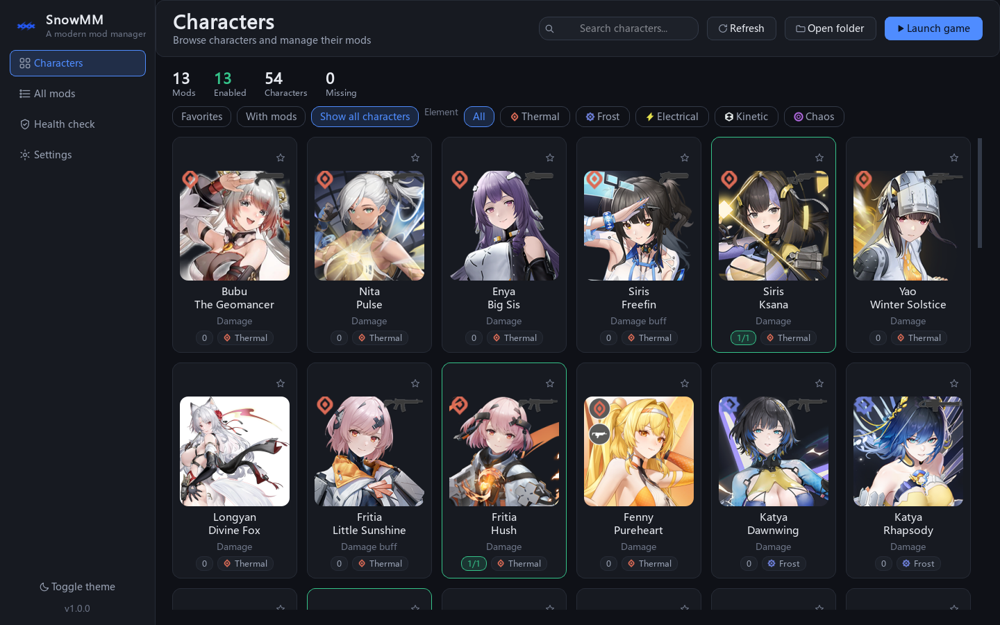
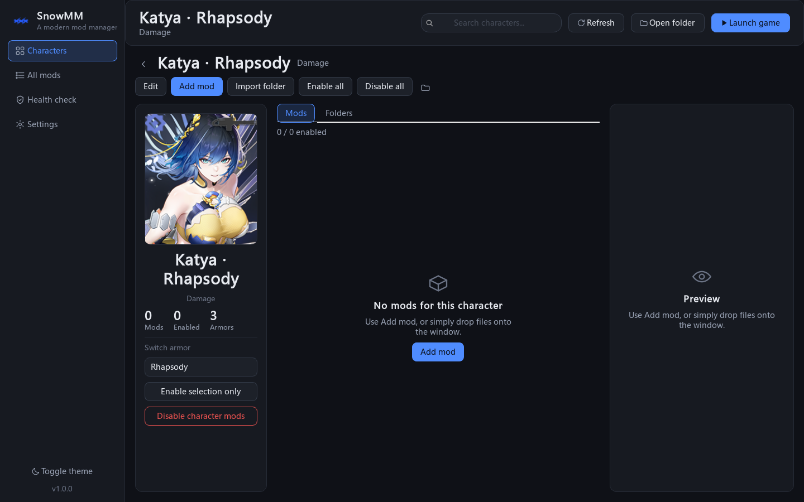

# SnowMM · Snowbreak Mod Manager

[简体中文](README.md) · [Changelog](CHANGELOG.md) · [Issues](https://github.com/theresa-2333/SnowMM/issues)

**v1.1.0** adds skin categories, automatic English-path compatibility, inline galleries, archive imports,
and Base / Miscellaneous cards. See [upgrade notes](docs/UPDATE_1.1.md).

## Run

Download `SnowMM-1.1.0-windows-x64.zip` from
[Releases](https://github.com/theresa-2333/SnowMM/releases).
Extract the **whole archive**, then run `SnowMM/SnowMM.exe`. Keep its `_internal` folder alongside it.

From source (Python 3.10+):

```powershell
python -m pip install -r requirements.txt
python main.py
```

First launch opens Settings. Select the game's mods directory, usually
`<game>/Game/Content/Paks/mods`, then scan to adopt existing mods.
Choose English in Settings; language changes apply immediately.





## Features

- 54 bundled operatives with clean portraits, damage-type filters, favorites, and search.
  Characters with no mods can still be opened.
- English character names, exosuit names, damage types, and interface text.
  Storage folders use stable English IDs; existing database character keys remain compatible.
- A default skin per armor plus 116 BWIKI outfits. Filter and import by skin; change a mod's skin in the inspector.
- Base and Miscellaneous cards skip duplicate checks while retaining missing-file checks.
- Import pak files, whole folders, or ZIP / 7z / RAR archives. Same-stem utoc, ucas, and sig
  companions are included automatically; each package receives its own record.
- Collision handling keeps one shared stem across a package. Toggle, rename, and move
  operations preflight destinations and attempt rollback on failure.
- Choose, drop, or paste a preview image. Click an existing image to view it in full,
  zoom with the wheel, drag to pan, select 100% or Fit, and press Esc to close.
- Switch to the enabled-mod gallery within character details or All Mods. Use Back to return. Toggle each card,
  navigate with arrow keys, or press Space to switch the selected mod.
- Missing files, duplicate records, multiple active mods, and unknown-character checks.
- Legacy record migration, directory conversion, backups, dark/light themes, and a new app icon.
- Selection survives refresh; pending notes are saved before selection/language changes or closing.
  Narrow windows collapse the portrait and secondary columns.

Shortcuts: F5 refreshes, Ctrl+F focuses search, and Ctrl+V pastes an image into the inspector.

## Storage and upgrades

Files are stored under `<mods>/<english-character-id>/[<english-skin-id>/]`.
Default skins stay at the character root. Utility folders are `Base` and `Miscellaneous`.
Enabled files retain their extensions; disabled files receive `.disabled`.
Companion files are toggled together. `_100_P` is optional, and existing suffixes are preserved.
Archives (`.zip/.7z/.rar`) are scanned recursively for packages and extracted to temporary staging.
RAR uses installed WinRAR / 7-Zip or bsdtar; solid RAR requires a capable backend such as UnRAR.
Encrypted, multipart and nested archives are not supported.
Non-ASCII package filenames receive stable ASCII names; display names retain their original text.

User data lives in `%APPDATA%/SnowMM/`: settings, database, previews, and backups.
Keep this directory when upgrading. The app can migrate `~/.snowbreak_mod_manager/projects.json`
and convert the old character/armor/outfit directory layout while updating tracked paths.
Startup, directory selection, scan and F5 automatically repair recognized legacy Chinese paths.
Repair backs up the database, preserves metadata, disabled state and companion groups,
and avoids collisions. The chosen mods root and unrelated folders stay in place.

## Development and release builds

```powershell
python -m unittest discover -s tests -t .
python tests/smoke_ui.py
python tests/regression_ui.py
python tests/update_ui.py
python tests/gallery_ui.py
python -m ruff check .
python -m pip install -e ".[dev]"
pwsh -NoProfile -File tools/build_exe.ps1
python tools/package_release.py
```

Release tooling creates portable Windows, source, and resource archives with SHA-256 hashes.
See [release instructions](docs/RELEASE.md). The old 0.2.x app remains under `snow_mod_manager/`.

## Credits

Portraits: [GameKee](https://www.gamekee.com/snow/second/61949), with Sparkdrive artwork from
[BWIKI](https://wiki.biligame.com/sonw/芙提雅·炬芯).
English names: [Snowbreak Wiki](https://snowbreak.fandom.com/wiki/Characters) and
[GachaData](https://gacha-data.com/snowbreak/characters/).
Individual image URLs and digests are recorded in `snowmm/assets/catalog/artwork.json`.
Interface inspiration: [JASM](https://github.com/Kiyanami/JASM).

This is an unofficial tool. Game artwork and trademarks belong to their respective owners.
See [third-party notices](THIRD_PARTY_NOTICES.md).
