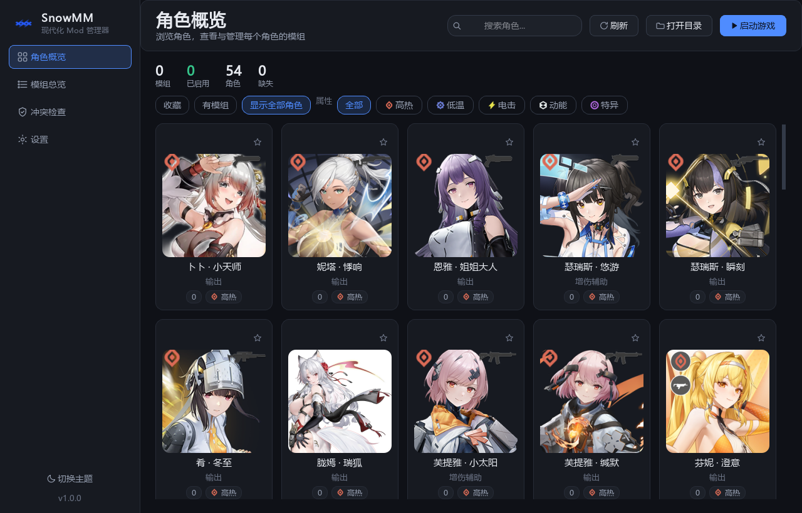
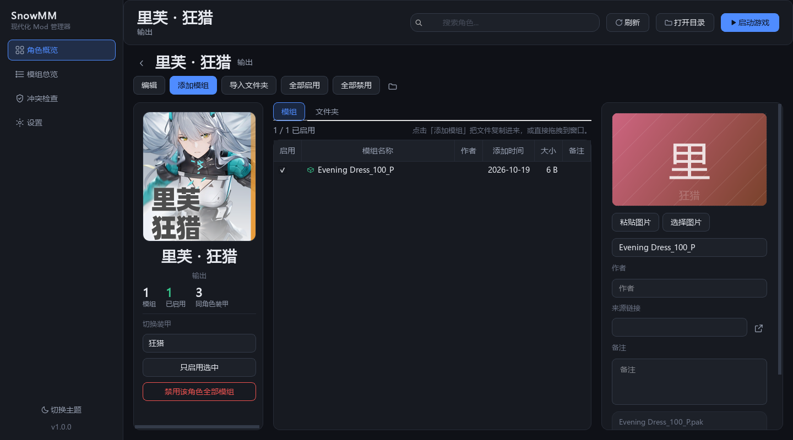
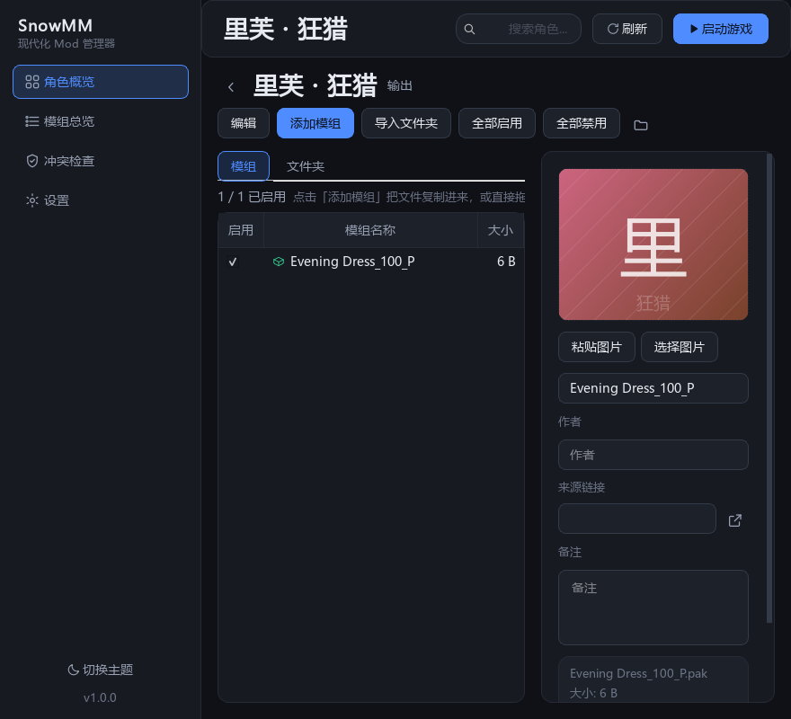

# 2026-10-19 重启开发与验收记录

## v1.0.0 资源与发布更新

- 应用标识基于提供的蓝色参考图使用内置 imagegen 重绘，保存透明母版、10 种 PNG 尺寸和多分辨率 ICO；窗口、任务栏与侧栏均接入新标识。提示词与文件说明见 `ICON_DESIGN.md`。
- 替换全部 54 张角色图；53 张来自 GameKee 无字角色卡片，炬芯补充自 BWIKI。人工查看整库联系表，排除仍带游戏姓名条的详情截图。来源、尺寸和 SHA-256 见内置 `artwork.json`。
- 核对并补齐 54 个英文角色/装甲名称；界面、搜索、下拉框、属性标签和检查页跟随语言变化，持久化角色键与文件夹名称保持中文。
- 检查中英界面截图，修复英文详情页长按钮/标题挤出横向滚动的问题。
- 57 项核心/资源/翻译检查、UI 冒烟、实际点击回归、Ruff 均通过。
- 正式 Windows EXE 已在隔离数据目录离屏运行，通过 54 张图片、英文名称、应用图标和页面导航自检。
- 构建发现 PATH 中 Poppler 的 ICU 被误收录；打包脚本现在隔离 PATH，避免将其他工具的不兼容 DLL 带入应用。
- 已提供 Windows 便携、源码、资源 ZIP 以及 wheel/sdist、双语发布说明与校验文件的构建和审计工具。完整步骤见 `RELEASE.md`。

## 后续反馈修复：角色卡片与图片放大

- 网格原先以内容宽度排版，卡片实际再加 30px，超过了 14px 的间距。现在传入网格的尺寸就是卡片总宽，立绘从总宽扣除内边距；排版同时考虑滚动容器的边距。
- 角色副标题和属性角标曾在拥有父控件前调用显示，短暂成为独立窗口。现在构造时就绑定父控件；筛选只隐藏、复用已有卡片。
- 原来的 `setProperty("enabled", ...)` 实际改动 Qt 的 QWidget 启用状态，导致没有已启用模组的卡片无法点击。样式改用独立属性 `hasEnabledMods`，空角色和全部模组禁用的角色均可正常打开。
- 角色详情、模组总览共用的检查器支持点击已有图片打开完整图片，滚轮缩放、拖动平移、100% 原图、适应窗口、Esc 关闭；无图片时仍可点击选择图片。拖入图片不会再额外弹出选择文件对话框。
- 新增 `python tests/regression_ui.py`：从初次创建开始监听顶层窗口的 Show 事件，能捕捉随即消失的窗口；在 880/940/1280/1600px 下反复真实点击筛选，检查卡片不相交、间距至少 14px、卡片对象复用，并实际点击立绘、名称、角标和收藏按钮。另验证空/禁用角色导航，以及完整图尺寸、缩放、100% 和 Esc 关闭。
- 53 项核心测试、原有 UI 冒烟、新增交互回归、Ruff 检查均通过。

## 恢复的要求

已回顾本地 2026-09-22 对话记录：继续采用 JASM 风格、内置立绘对应的 54 位角色、角色全名一级目录、角色详情页导入、剪贴板预览图、中英双语。保持已删除的排序、预设和 ini 功能现状；压缩包导入继续暂停。

## 本轮修复

1. 文件夹中有多组模组时，现在全部登记；选择 pak 时自动寻找同名 utoc、ucas、sig，多选同组文件不重复登记。
2. 重名检查覆盖配套文件和已禁用文件，整组使用同一个新 stem，保留 `_100_P` 后缀。
3. 启停、改名、移动先检查碰撞，运行期间出错时尝试回滚；启停结果按磁盘真实状态展示。回滚失败也会报告。
4. 删除文件失败时保留模组记录；同 stem 的 txt、图片和目录不会被启停或删除。
5. 目录转换识别 `.disabled` 文件，整组移动并同步数据库，避免转换后记录全部失效。
6. 表格刷新保留多选与滚动位置，空搜索结果清除旧检查器，防止编辑不可见的旧模组。
7. 待保存的备注在切换模组、切换语言和关闭窗口前写入。
8. 角色详情页增加「导入文件夹」。文件夹和多文件导入保留各自的模组名。
9. 880px 窄窗口收起立绘栏与次要表格列，确保名称列仍可读；检查器按钮换行，预览图适配面板宽度。
10. 首次启动进入设置；F5 刷新、Ctrl+F 搜索；无有效模组的导入显示明确提示。

## 验证

- `python -m unittest discover -s tests -t .`：53 项通过。
- `python tests/smoke_ui.py`：离屏 UI 冒烟通过，覆盖导航、固定角色名单、筛选、反复重排、启停、归属修改、多选保留、待保存备注、880–1600px 布局、中英切换。
- `python -m ruff check .`：通过。
- 使用独立临时数据目录和模拟模组文件验证，没有操作真实游戏模组。
- 检查了 1440px 和 880px 的界面截图。离屏渲染显式加载系统字体，中文可读。

## 验证边界

尚未用真实游戏验证挂载行为，也未在真实文件锁、磁盘已满或跨卷故障环境下实测。部分错误通过故障注入验证。此次完成上述操作链的修复，不代表项目所有潜在问题均已排除。压缩包支持仍未恢复。
